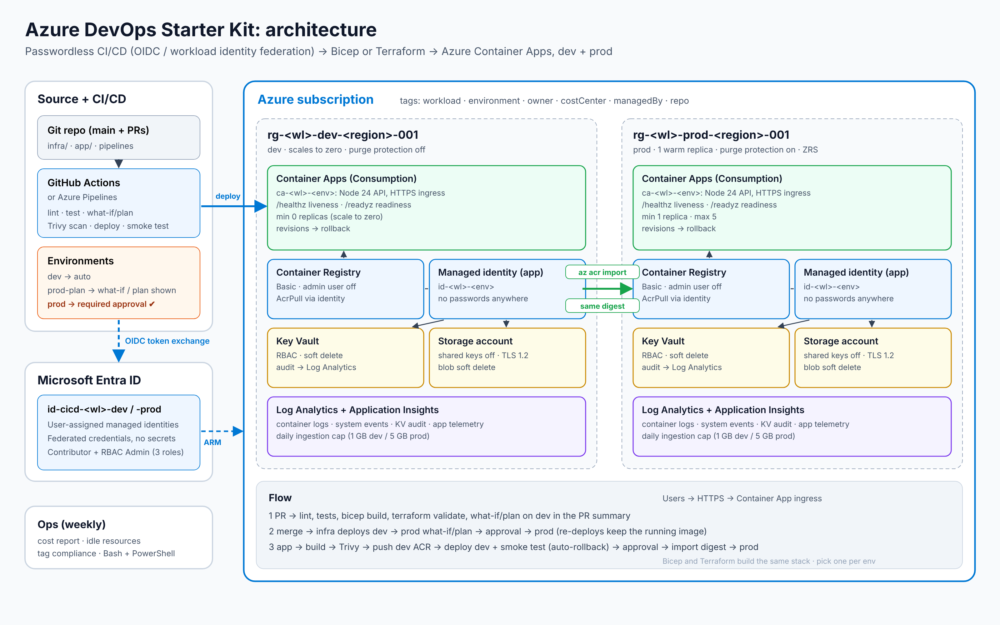

# Azure Container Apps CI/CD with GitHub OIDC (no stored secrets)

A small, complete example of shipping a container to **Azure Container Apps** from **GitHub Actions**, where the pipeline signs in to Azure with **OpenID Connect (workload identity federation)**. There are no client secrets, no registry passwords, and nothing to rotate.

On every push to `main`:

```
test → docker build → Trivy scan → push to ACR (by digest) → deploy → smoke test /healthz → auto-rollback if it fails
```

> **About this repo.** This is a personal lab project built to demonstrate the workflow end to end. It is not a client production system. It is the free sample of a larger paid kit (see the end of this README).

## What's here

| Path | What it is |
|---|---|
| `examples/workflows/container-app.yml` | Copy into `.github/workflows/` in your repo. The pipeline: OIDC login, build, scan, push, deploy, smoke test, rollback. Actions pinned to commit SHAs |
| `bootstrap/setup-azure.sh` | One-time Azure setup with the az CLI: registry, Container Apps environment, app, app identity (AcrPull), and the CI identity with a federated credential |
| `scripts/ci/` | `find-resources.sh` (locates resources by tag) and `deploy-containerapp.sh` (deploy, smoke test, rollback) |
| `app/` | Zero-dependency Node.js 24 API (`/`, `/healthz`, `/readyz`, `/info`), unit tests, non-root Dockerfile |
| `naming/` | Azure naming convention as a Bicep module **and** a Terraform module that produce identical names |

## How the passwordless login works

1. `setup-azure.sh` creates a **user-assigned managed identity** for CI and adds a **federated credential** that trusts exactly one thing: GitHub tokens with subject `repo:<owner>/<repo>:environment:dev`.
2. The deploy job declares `environment: dev` and `permissions: id-token: write`, so GitHub issues it a short-lived OIDC token.
3. `azure/login` exchanges that token with Microsoft Entra ID for an Azure access token. Nothing is stored in GitHub Secrets. The three values in GitHub *Variables* are IDs, not credentials.
4. The CI identity has **Contributor on one resource group** and **AcrPush on one registry**, and nothing else.
5. The Container App pulls images with **its own** managed identity (AcrPull). The registry's admin user is disabled.

## Try it (about 15 minutes, about $5/month while it exists)

```bash
az login && az account set -s <subscription-id>
./bootstrap/setup-azure.sh -w demo -g <github-owner>/<repo> -l westus3
```

Then in GitHub:

1. *Settings > Environments > New environment* `dev`. Optionally add yourself as a required reviewer.
2. Add the three **variables** the script printed (`AZURE_CLIENT_ID`, `AZURE_TENANT_ID`, `AZURE_SUBSCRIPTION_ID`) to the `dev` environment.
3. *Actions > container-app > Run workflow*. The last step prints the app URL.

Run it locally:

```bash
cd app && npm test && npm start   # http://localhost:8080/
```

Cost: the Basic container registry is about $5/month (West US 3 list price, Nov 2026). The app scales to zero and normally fits in the Container Apps monthly free grant. **Tear down**: `az group delete -n rg-demo-dev-wus3-001`.

## Want the full version?

**Azure DevOps Starter Kit** builds on this repo with:

- The whole landing baseline in **Bicep and Terraform** (Key Vault, Storage, Log Analytics + App Insights, managed identities, tags, dev/prod params)
- **dev → prod promotion** of the same image digest, behind a **manual approval** with the what-if/plan shown first
- The same flows as **Azure Pipelines** YAML (managed-identity service connections), plus Terraform plan/apply pipelines
- Least-privilege bootstrap: CI can assign only three specific roles
- Cost, idle-resource and tag-compliance scripts (Bash + PowerShell) with a weekly scheduled report
- An illustrated setup guide (PDF), cost/security/troubleshooting docs, and 8 hands-on labs



👉 **Get the full kit: https://joshwave313.gumroad.com/l/azure-devops-starter-kit**

## License

MIT. See [LICENSE](LICENSE).
